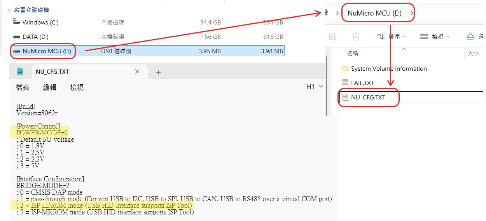
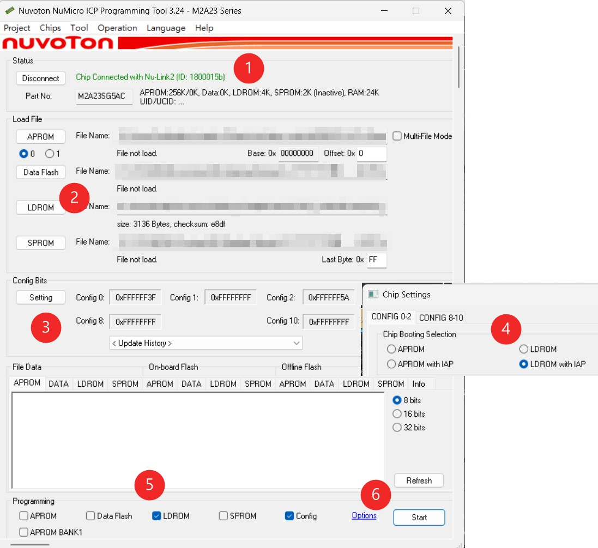
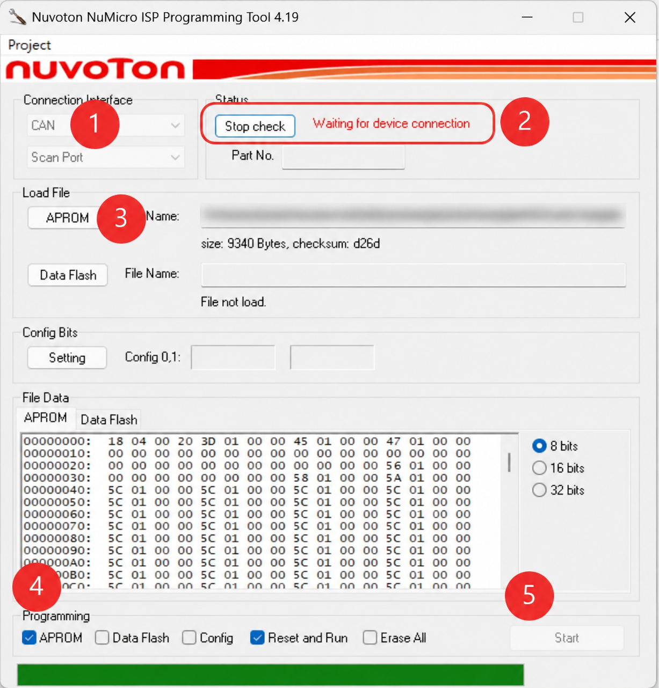
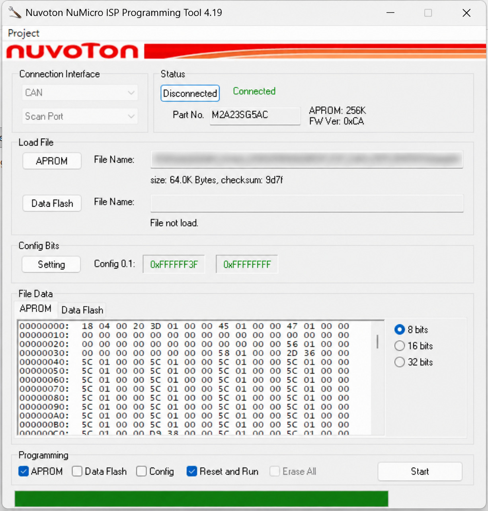
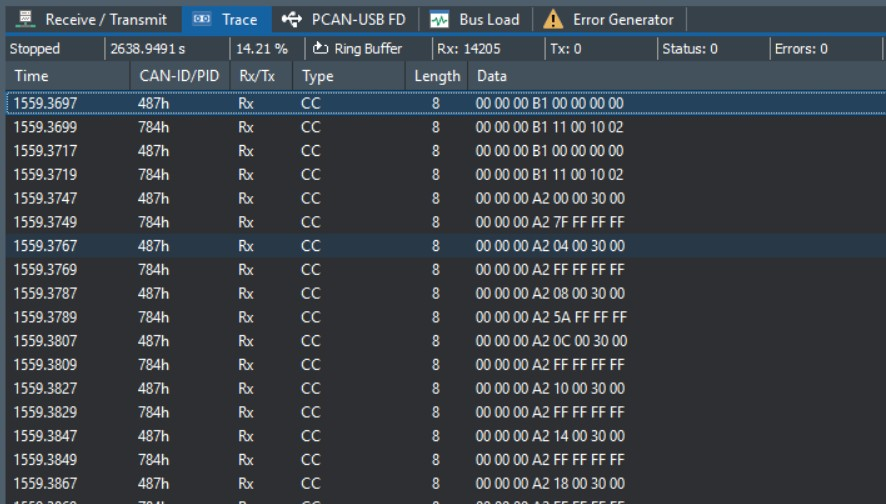

# M2A23 CAN ISP APP Entry

本專案示範在 M2A23 APROM 應用程式執行期間，辨識 Nu-Link2-Pro CAN ISP bridge 的連線要求，並在適當時間重置 MCU，使原始 BSP `ISP_CAN` 可重新取得後續 ISP Tool 命令。

專案由兩部分組成：

- `SampleCode/Template/ISP_CAN`：原始 M2A23 BSP CAN ISP，燒錄至 LDROM。
- `SampleCode/Template/AP`：沿用 `M2A23BSP_ISP_CAN_PWM_LIN` 的主程式與 service 架構，移除本範例不需要的 GPIO、LIN、ADC、PWM 功能，並加入可獨立移植的 `app_can_isp_entry.c/.h`。

`ISP_CAN` 不需加入應用程式 checksum 檢查，也不需修改 ISP Tool 或原始 BSP CAN ISP 通訊流程。

## 運作流程

1. Nu-Link2-Pro 進入 ISP bridge mode 2，ISP Tool 選擇 CAN 並送出連線要求。
2. APROM 收到 Standard CAN ID `0x487`、DLC 8、資料 `00 00 00 B1 00 00 00 00`。
3. `APP_CAN_ISP_ENTRY_OnRx()` 完整比對 frame 後啟動非阻塞延遲。
4. `APP_CAN_ISP_ENTRY_Process()` 在預設 `4960 ms` 後呼叫 `SYS_ResetChip()`。
5. Config 設為 `Boot from LDROM w/ IAP`，因此 MCU reset 後由 LDROM 的 `ISP_CAN` 啟動。
6. ISP Tool 約每 5 秒重送連線要求；LDROM 接收下一次要求後進入 CAN ISP 更新流程。

預設 `4960 ms` 可由 `APP_CAN_ISP_ENTRY_RESET_DELAY_MS` 調整。此時間用於讓 reset 發生在 ISP Tool 下一次週期性連線要求之前，並非 CAN ISP protocol 固定參數。

## Nu-Link2-Pro 設定

Nu-Link2-Pro 必須切換為 ISP bridge mode：

1. 將 Nu-Link2-Pro 連接至電腦。
2. 開啟裝置磁碟中的 `NU_CFG.TXT`。
3. 將設定改為：

   ```text
   BRIDGE-MODE=2
   ```

4. 儲存後重新插拔 Nu-Link2-Pro，使設定生效。
5. 啟動 Nuvoton NuMicro ISP Programming Tool，Connection Interface 選擇 `CAN`。



上圖顯示 Nu-Link2-Pro 會以 `NuMicro MCU` USB 磁碟出現。開啟根目錄的 `NU_CFG.TXT`，在 `[Interface Configuration]` 區段確認 `BRIDGE-MODE=2`。圖中的 `POWER-MODE=2` 是 target I/O voltage 設定，與 ISP bridge mode 是不同項目，應依實際 target board 電壓需求設定。

Bridge mode 2 會啟用供 ISP Tool 使用的 HID ISP bridge，並支援包含 CAN 在內的 ISP 通訊介面。設定方式與 mode 定義請參考 [Nu-Link2-Pro 官方使用說明](https://github.com/OpenNuvoton/Nuvoton_Tools/blob/master/Documents/Nu-Link2_Nu-Link3_User_Manual/docs/01_overview/01_nu-link2-pro.md)。

## 初次燒錄

初次建立裝置時，使用 ICP Tool 完成 LDROM 與 Config 設定：

1. 開啟並建置 `SampleCode/Template/ISP_CAN/KEIL/ISP_CAN.uvprojx`。
2. 確認 ISP_CAN linker 的 R/O Base 為 `0x00100000`。
3. 使用 ICP Tool 將 ISP_CAN image 燒錄至 LDROM。
4. 將 Config 設為 `Boot from LDROM w/ IAP`。
5. 開啟並建置 `SampleCode/Template/AP/KEIL/Template.uvprojx`。
6. 使用 ISP Tool 的 CAN 介面連線，將 AP image 更新至 APROM。



ICP Tool 圖中標示項目如下：

| 編號 | 操作 |
| --- | --- |
| 1 | 使用 Nu-Link2-Pro 連接 target MCU，並確認 Part No. 正確。 |
| 2 | 按下 `LDROM`，載入由 `ISP_CAN` target 產生的 image。 |
| 3 | 按下 Config Bits 的 `Setting` 開啟 Chip Settings。 |
| 4 | Chip Booting Selection 選擇 `LDROM with IAP`。 |
| 5 | Programming 勾選 `LDROM` 與 `Config`。 |
| 6 | 確認設定後按下 `Start`，將 ISP_CAN 與 Config 寫入 target MCU。 |

首次燒錄完成後，MCU reset 會先由 `0x00100000` 的 LDROM ISP_CAN 啟動，再依 CAN ISP 流程更新或執行 APROM。



圖中標示項目如下：

| 編號 | 操作 |
| --- | --- |
| 1 | Connection Interface 選擇 `CAN`。 |
| 2 | 按下 Connect 後顯示 `Waiting for device connection`；按鈕會暫時顯示為 `Stop check`。 |
| 3 | 按下 `APROM` 並載入要更新的 APROM image。 |
| 4 | Programming 勾選 `APROM`；更新後需直接執行新程式時可同時勾選 `Reset and Run`。 |
| 5 | CAN ISP 完成連線後，`Start` 會變為可操作，按下後開始燒錄。 |

AP linker 起始位址維持 `0x00000000`。本範例不依賴 APROM checksum 決定是否停留在 boot loader。

## 後續更新

裝置已有 APROM 程式時，操作順序如下：

1. Nu-Link2-Pro 保持 `BRIDGE-MODE=2`，CANH、CANL 與 GND 正確連接至 target board。
2. ISP Tool 選擇 CAN，按下 `Connect`。
3. APROM 偵測 `0x487/B1` 連線要求並開始計時；主程式在此期間仍可執行既有工作。
4. 延遲到期後 MCU reset，並由 LDROM 啟動。
5. LDROM 的 BSP `ISP_CAN` 接收 ISP Tool 下一次連線要求，ISP Tool 完成連線。
6. 選擇 APROM image 並執行更新。



連線成功後，Status 顯示 `Connected` 並列出 M2A23 Part No.，`Start` 按鈕會變為可操作。圖中的 APROM image 為 64 KB，包含位於 `0x0FFFC` 的 CRC32。

若 reset 與 ISP Tool 的重送時點未銜接，APROM 可在下一次 `0x487/B1` 要求重新啟動相同流程，不需在主迴圈加入數秒的 blocking delay。

## 模組 API

`app_can_isp_entry.c/.h` 提供三個移植介面：

| API | 用途 |
| --- | --- |
| `APP_CAN_ISP_ENTRY_Init()` | 由 CAN driver 傳入保留且未被其他功能使用的 Standard ID filter index，設定 `0x487` exact-match filter 並清除模組狀態。 |
| `APP_CAN_ISP_ENTRY_OnRx()` | 觀察已成功讀出的 CAN frame，完整比對 ID、frame type、DLC 與 8-byte data。 |
| `APP_CAN_ISP_ENTRY_Process()` | 在主迴圈執行非阻塞計時，時間到後解鎖 protected register 並重置 MCU。 |

模組只記錄事件與執行 reset，不會改寫既有 CAN frame parser，也不會主動送出 ISP response。

## 移植方式

### 1. 複製模組

將以下檔案複製至目標 APROM 專案，並把 `.c` 加入 IDE project：

```text
app_can_isp_entry.c
app_can_isp_entry.h
```

### 2. 在既有 SID filters 完成後加入 exact filter

`APP_CAN_ISP_ENTRY_Init()` 必須放在 `CANFD_Open()` 之後、最後一次可能寫入同一 slot 的 `CANFD_SetSIDFltr()` 之後，以及 RX interrupt 與 Normal mode 啟用之前。`CANFD_SetGFC()` 不會改寫 SID filter table，因此可位於 ISP entry filter 的前面或後面。CAN driver 必須明確保留一個不會再被其他初始化流程使用的 Standard ID filter index，不可假設 index 0 一定空閒。

下例的既有 application filters 連續使用 index `0` 到 `eDRV_CAN_RX_CHANNEL_COUNT - 1`，因此 ISP entry 使用 index `eDRV_CAN_RX_CHANNEL_COUNT`：

```c
CANFD_Open(CANFD0, &sCANFD_Config);

for (u8ChannelIndex = 0U;
     u8ChannelIndex < (uint8_t)eDRV_CAN_RX_CHANNEL_COUNT;
     u8ChannelIndex++)
{
    CANFD_SetSIDFltr(CANFD0,
                     (uint32_t)u8ChannelIndex,
                     au32ApplicationFilter[u8ChannelIndex]);
}

if (APP_CAN_ISP_ENTRY_Init(CANFD0,
                           (uint32_t)eDRV_CAN_RX_CHANNEL_COUNT) == 0U)
{
    printf("CAN ISP entry filter init failed\n");
}

CANFD_SetGFC(CANFD0,
             eCANFD_REJ_NON_MATCH_FRM,
             eCANFD_REJ_NON_MATCH_FRM,
             1U,
             1U);
```

常見範本的 index 選擇如下：

| 既有 filter 架構 | ISP entry index | 呼叫位置 |
| --- | --- | --- |
| 沒有呼叫 `CANFD_SetSIDFltr()` | `0U` | `CANFD_Open()` 後、RX interrupt 前 |
| 固定使用 index `0`，包含 compile-time enable/disable 分支 | 保留 `1U` | 整個條件式 filter/GFC 區塊後、RX interrupt 前 |
| loop 連續使用 `0..COUNT-1` | `COUNT` | loop 結束後、RX interrupt 前 |
| 非連續或由多個模組配置 | 由 CAN driver 明確保留的空 slot | 最後一次可能寫入該 slot 的程式之後 |

即使某個 compile-time 分支目前未啟用既有 filter，也應保留同一個 ISP entry slot，避免切換設定後發生 index 衝突。目前專案沒有其他 SID filter，因此 `drv_can_fd.c` 將 driver-local `CAN_APP_ISP_ENTRY_SID_FILTER_INDEX` 設為 `0U`。

`APP_CAN_ISP_ENTRY_Init()` 內部使用 Standard ID mask `0x7FF`，只讓指定 filter element 精確匹配 `0x487`，並導向 RX FIFO0。API 會讀取 `CANFD_SIDFC.LSS` 驗證 index 是否落在已配置的 Standard ID filter table 內；若 table 沒有空間則回傳 `0U`。

不可先呼叫 `APP_CAN_ISP_ENTRY_Init()`，再讓後續 loop 或固定 index 設定寫入同一 slot，否則 `0x487` filter 會被覆蓋。預設 BSP configuration 配置 12 個 Standard ID filter elements，但仍應以實際專案的 `sElemSize.u32SIDFC` 與既有占用情形為準。

若目標專案的 Global Filter Configuration 仍接受所有 non-matching frame，新增 exact filter 不會阻擋其他既有 CAN ID。若目標專案設定為 reject non-matching frame，則此 filter 可確保 `0x487` 被硬體接收。

### 3. 在成功讀取 RX frame 後加入 observer

在 `CANFD_ReadRxFifoMsg()` 回傳非 empty 後、既有 parser 或清除 RX buffer 之前呼叫：

```c
u32RxResult = CANFD_ReadRxFifoMsg(CANFD0, 0, &g_sRxMsgFrame);
if (u32RxResult != eCANFD_RECEIVE_EMPTY)
{
    APP_CAN_ISP_ENTRY_OnRx(&g_sRxMsgFrame, u32TickMs);
    CAN_PrintRxMessage(0, &g_sRxMsgFrame);
    CAN_ParseRxMessage(&g_sRxMsgFrame);
}
```

若專案同時使用 RX FIFO0 與 RX FIFO1，兩個成功讀取路徑都可加入 observer。函式會自行排除 Extended ID、remote frame、CAN FD frame、非 8-byte frame 及資料不符的 frame。

### 4. 在主迴圈加入 service

在既有 `CAN_Process()` 後呼叫：

```c
while (1)
{
    u32TickMs = APP_GetTickMs();
    CAN_Process(u32TickMs);
    APP_CAN_ISP_ENTRY_Process(u32TickMs);
}
```

`u32TickMs` 必須是單調遞增的 1 ms tick。模組使用 unsigned subtraction，比較方式可容許 32-bit tick rollover。

### 5. 確認 boot 設定

- ISP_CAN 位址：`0x00100000`。
- APROM 位址：`0x00000000`。
- Config：`Boot from LDROM w/ IAP`。
- LDROM：使用原始 BSP `ISP_CAN`。

## 範例腳位與通訊設定

Debug UART 由 `main.c` 的 `APP_DEBUG_UART_SELECT` 選擇，baud rate 固定為 115200 bps：

| `APP_DEBUG_UART_SELECT` | 適用板子 | UART | RXD | TXD |
| --- | --- | --- | --- | --- |
| `APP_DEBUG_UART_CUSTOM_PCB` | Custom PCB（預設） | UART1 | PB.6 | PB.7 |
| `APP_DEBUG_UART_M2A23_EVB` | M2A23 EVB | UART0 | PB.12 | PB.13 |

程式內預設設定如下，也可由 Keil compiler define 覆寫：

```c
#define APP_DEBUG_UART_SELECT APP_DEBUG_UART_CUSTOM_PCB
```

- CANFD0：PC.4 RXD、PC.5 TXD。
- Nominal bit rate：500 kbit/s。
- Data bit rate：2 Mbit/s。
- AP 可接收 Classical CAN 與 CAN FD frame；ISP entry request 必須是 Classical CAN 8-byte frame。

## 驗證重點

- CAN analyzer 可看到 ISP Tool 週期性送出 Standard ID `0x487` 與資料 `00 00 00 B1 00 00 00 00`。
- 目前範例的 GFC 會把 non-matching Standard frame 送入 RX FIFO0，因此 UART 顯示收到 `0x487` 只證明 RX observer 正常，不能單獨證明 exact filter slot 未被覆蓋。
- exact filter 驗證至少要確認初始化順序與 slot ownership；隔離測試時可暫時 reject non-matching Standard frame，確認 `0x487` 仍可接收、其他未設定 SID 不會進入 RX FIFO。
- 不完整資料、錯誤 DLC、Extended ID、CAN FD frame 或其他 CAN ID 不應觸發 reset。
- 收到正確要求後，MCU 約於 `APP_CAN_ISP_ENTRY_RESET_DELAY_MS` 到期時 reset。
- reset 後 ISP Tool 應可連線，並可更新 APROM。
- 一般 CAN RX、TX 與 Bus-Off recovery 行為不應受到影響。



圖中的 `0x487` 為 ISP Tool request、`0x784` 為 target response，`B1` 為連線交握，後續 `A2` frame 為 ISP 資料傳輸。Type `CC` 表示 Classical CAN，frame 長度為 8 bytes。
